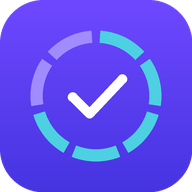

<div align="center">



# Yeho Habits 

**A Persian-first, installable habit tracker with Jalali calendar support, Google Sheets export, and friendly competition.**

[](https://nextjs.org/)
[](https://www.typescriptlang.org/)
[](https://supabase.com/)
[](https://tailwindcss.com/)
[](#)
[](#-run-with-docker-compose)

</div>

---

## Table of Contents

- [Overview](#overview)
- [Features](#features)
- [Tech Stack](#tech-stack)
- [Project Structure](#project-structure)
- [Getting Started](#getting-started)
  - [Prerequisites](#prerequisites)
  - [1. Configure Supabase](#1-configure-supabase)
  - [2. Configure Google Cloud](#2-configure-google-cloud)
  - [3. Environment Variables](#3-environment-variables)
  - [4. Run Locally](#4-run-locally)
- [Deployment](#deployment)
- [First-Time Setup in the App](#first-time-setup-in-the-app)
- [How Google Sheets Export Works](#how-google-sheets-export-works)
- [Friends & Leaderboard](#friends--leaderboard)
- [Security Notes](#security-notes)
- [Scripts](#scripts)
- [Contributing](#contributing)

---

## Overview

**Yeho Habits** (عادت‌ها) is a right-to-left, Persian-language Progressive Web App for building daily routines. It uses the **Jalali (Solar Hijri) calendar** throughout, stores data in **Supabase**, and can export any month's habit board to a **Google Sheet** in your Drive.

## Features

| Area | What you get |
| --- | --- |
| ✅ **Habits** | Daily check-offs with flexible, Google-Calendar-style recurrence (every *N* days / weeks / months, specific weekdays, end date or occurrence count). Archive habits without losing history. |
| 📝 **To-dos** | A lightweight task list alongside your habits. |
| 📅 **Jalali calendar** | Native Solar Hijri dates, month names and weekdays (Saturday-first), with a custom date picker. Times default to `Asia/Tehran`. |
| 📊 **Statistics** | Progress charts and completion trends over time. |
| 🍅 **Pomodoro** | Built-in focus timer. |
| 📤 **Google Sheets export** | One-click, one-way export of a month's habit board to a spreadsheet in your Drive (one tab per month). |
| 🗓️ **Google Calendar** | Push habits and to-dos as reminders or meetings — via OAuth, or via a personal Google Apps Script web app (no Cloud Console needed). |
| 👥 **Friends** | Send friend requests by email, compare monthly rankings and view each other's habit boards. Mark any habit as hidden from friends. |
| 📱 **PWA** | Installable on iOS/Android/desktop with a service worker and maskable icons. |

## Tech Stack

- **Framework:** [Next.js 14](https://nextjs.org/) (App Router) + React 18 + TypeScript
- **Styling:** Tailwind CSS, [Vazirmatn](https://github.com/rastikerdar/vazirmatn) variable font
- **Backend:** [Supabase](https://supabase.com/) — Postgres, Auth, Row Level Security
- **Integrations:** Google Sheets API, Google Calendar API (`google-auth-library`), Google Apps Script
- **Dates:** [`jalaali-js`](https://github.com/jalaali/jalaali-js)
- **Deployment:** Docker / Docker Compose or Vercel

## Project Structure

```
.
├── public/                  # PWA manifest, service worker, icons
├── src/
│   ├── app/
│   │   ├── (app)/           # Authenticated pages
│   │   │   ├── page.tsx     #   Today / dashboard
│   │   │   ├── habits/      #   Habit management
│   │   │   ├── todos/       #   To-do list
│   │   │   ├── stats/       #   Charts & statistics
│   │   │   ├── pomodoro/    #   Focus timer
│   │   │   ├── friends/     #   Friends & leaderboard
│   │   │   └── settings/    #   Google connection, preferences
│   │   ├── api/
│   │   │   ├── google/      #   OAuth connect & callback
│   │   │   ├── calendar/    #   Calendar event create/delete
│   │   │   ├── sheets/      #   Google Sheets export
│   │   │   └── apps-script/ #   Apps Script connection test
│   │   ├── auth/callback/   # Supabase auth callback
│   │   └── login/
│   ├── components/          # UI, charts, recurrence editor, calendar picker…
│   ├── lib/                 # Supabase clients, Google helpers, Jalali & recurrence logic
│   └── middleware.ts        # Session / route protection
├── supabase/
│   ├── schema.sql           # Core tables & policies
│   └── friends.sql          # Friends feature (run after schema.sql)
├── Dockerfile
├── docker-compose.yml
└── .env.example
```

## Getting Started

### Prerequisites

- **Node.js 20+** and **pnpm** (for local development), or **Docker** with Compose
- A **Supabase** project (the free tier is enough)
- *(Optional)* A **Google Cloud** project — only for Calendar via OAuth. Not needed if you use the Apps Script option (recommended).

### 1. Configure Supabase

1. Create a new project, open **SQL Editor**, and run the contents of [`supabase/schema.sql`](supabase/schema.sql).
2. *(Optional — friends feature)* Run [`supabase/friends.sql`](supabase/friends.sql) afterwards.
   > **Upgrading an existing database?** Also run the dated files in `supabase/` (e.g. `2026-11-habit-logs-ownership.sql`); `schema.sql` already includes them for new projects.
3. Under **Authentication → Providers**, make sure **Email** is enabled.
   > For quick local testing you may disable *Confirm email*, but **keep it enabled in production** (see [Security Notes](#security-notes)).
4. From **Project Settings → API**, copy the project **URL**, **anon key**, and **service_role key**.

### 2. Configure Google Cloud

1. Create a project and enable the **Google Calendar API**.
2. Configure the **OAuth consent screen** as *External* and set its publishing status to **In production**.
   > In *Testing* mode, refresh tokens expire after 7 days. The "unverified app" warning is fine for personal use.
3. Go to **Credentials → Create credentials → OAuth client ID → Web application** and add these **Authorized redirect URIs**:
   ```
   http://localhost:3000/api/google/callback
   https://<your-domain>/api/google/callback
   ```

> **No Google Cloud?** You can skip this step entirely. The Settings page provides a ready-made Google Apps Script you deploy as a web app from your own Google account and paste into the app; it handles both **calendar reminders** and the **Google Sheets export**.

### 3. Environment Variables

```bash
cp .env.example .env
```

| Variable | Description |
| --- | --- |
| `APP_URL` | Public base URL of the app (e.g. `http://localhost:3000` or `https://your-domain.com`) |
| `NEXT_PUBLIC_SUPABASE_URL` | Supabase project URL |
| `NEXT_PUBLIC_SUPABASE_ANON_KEY` | Supabase anon (public) key |
| `SUPABASE_SERVICE_ROLE_KEY` | Supabase service-role key — **server-side only, never expose** |
| `GOOGLE_CLIENT_ID` | Google OAuth client ID |
| `GOOGLE_CLIENT_SECRET` | Google OAuth client secret |

### 4. Run Locally

**With pnpm**

```bash
pnpm install
pnpm dev
# → http://localhost:3000
```

**With Docker Compose**

```bash
docker compose up -d --build
# → http://localhost:3000
```

The container runs with `TZ=Asia/Tehran` and includes a health check against `/login`.

## Deployment

### Vercel

1. Import this repository into Vercel.
2. Add the six environment variables above, setting `APP_URL=https://<your-domain>`.
3. Deploy, then add `https://<your-domain>/api/google/callback` to your Google OAuth redirect URIs.

### Self-hosted (Docker)

Use the provided `Dockerfile` / `docker-compose.yml` behind any reverse proxy (Nginx, Caddy, Traefik) with HTTPS. Note that `NEXT_PUBLIC_*` variables are passed as **build args**, so rebuild the image after changing them.

## First-Time Setup in the App

1. Sign up / sign in with your email.
2. In **Settings → Google Calendar**, copy the Apps Script code, deploy it at [script.new](https://script.new) as a web app (*Execute as: Me*, *Who has access: Anyone*), and paste the `/exec` URL into the app.
3. In **Settings → Google Sheets export**, click a month to export it. The first export creates a spreadsheet in your Drive; later exports reuse it.

## How Google Sheets Export Works

- **One-way:** the database is the only source of truth. Exporting writes the month's board to the sheet; edits made in the sheet are **not** read back.
- **Layout:** one tab per Jalali month (e.g. `آبان ۱۴۰۵`), one row per habit, one column per day: `✓` done, empty = due but not done, `–` = not scheduled that day. The last columns show done count, target and percentage.
- **Re-exporting** a month clears and rewrites that tab, so it always matches the app.
- **Archived habits** appear only in months where they have check-offs.
- If you delete the spreadsheet, the next export creates a new one.
- The export runs through **your own Apps Script** (no Google Cloud project, no OAuth). If you installed the script before the export existed, paste the new code and redeploy with **Manage deployments → Edit → Version: New version**; the URL stays the same and Google will ask once for spreadsheet access.

## Friends & Leaderboard

1. Make sure `supabase/friends.sql` has been applied.
2. On the **Friends** page, enter a friend's email to send a request. They sign in with that same email and accept it.
3. Once accepted, you both see the monthly ranking and each other's habit boards.
4. Any habit can be marked **Hidden from friends** in its edit form.

## Security Notes

- The app never reveals whether an email address is registered.
- Friend data is only readable after a request is accepted, through the secured `friend_board` database function.
- Enable **Confirm email** in Supabase in production so nobody can register with someone else's address.
- `SUPABASE_SERVICE_ROLE_KEY` and `GOOGLE_CLIENT_SECRET` are server-only secrets — never commit `.env`.

## Scripts

| Command | Description |
| --- | --- |
| `pnpm dev` | Start the dev server on `0.0.0.0:3000` |
| `pnpm build` | Production build |
| `pnpm start` | Run the production build |
| `pnpm lint` | Type-check with `tsc --noEmit` |

## Contributing

Issues and pull requests are welcome. Before submitting a PR, please run `pnpm lint` and make sure the app builds with `pnpm build`.

---

<div align="center">
Made with ❤️ for building better days, one habit at a time.
</div>
